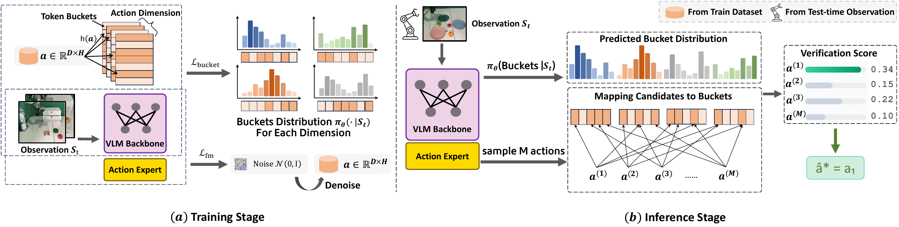

<div align="center">

# TokenPB

### TokenPB: Enabling VLA Action Self-Verification via VLM Token Probability Bucketing

**Token Probability Bucketing for Vision-Language-Action models**


[Overview](#overview) · [Installation](#installation) · [Data](#data) · [Training](#training) · [Inference](#inference) · [π0.5 Port](#pi05-port)

</div>

---

> 🎉 **Accepted to NeurIPS 2026!**

<p align="center">
  <a href="assets/paper-overview.pdf">
    
  </a>
  <br>
  <sub>Training (left) and inference (right). Click the figure to view the original PDF.</sub>
</p>

**Token Probability Bucketing (TokenPB)** unifies action generation and self-verification within a single VLA checkpoint. A flow-matching action expert generates continuous candidate action chunks, while the VLM backbone learns observation-conditioned distributions over bucket-token sequences. At inference, candidates are tokenized and scored through teacher-forced evaluation, and the candidate with the lowest average negative log-likelihood (NLL) is selected.

## Overview

| Component | Role |
| :--- | :--- |
| **Vision-language backbone** | Qwen2.5-VL or InternVL-3.5 processes visual observations and the task instruction. |
| **Action expert** | A flow-matching DiT generates continuous action chunks. |
| **Action representation** | Token bucketing maps continuous actions to discrete representations; the implementation supports FAST-based encodings and action bins. |
| **Training objective** | Flow-matching loss for the action expert + an auxiliary bucket-token prediction loss for the VLM backbone. |
| **Self-verification** | Rank candidates by average NLL and return the lowest-scoring action chunk. Minimizing NLL gives the same ranking as minimizing perplexity. |

The Qwen verification path includes **batched draft sampling**, **batched FAST encoding**, and **prefix KV-cache reuse** with GPU-side NLL scoring. If cache reuse fails, verification falls back to full recomputation.

## Installation

Run the following commands from the repository root. Use a CUDA-capable environment for training and inference.

```bash
# Create the environment and install the bundled LeRobot package.
conda create -y -n lerobot2.1 python=3.10
conda activate lerobot2.1
pip install -e ./lerobot

# Install training and inference dependencies.
pip install transformers==4.50.3 accelerate==1.6.0 deepspeed==0.15.4 \
    matplotlib qwen_vl_utils tensorboard uvicorn fastapi

# Install a FlashAttention wheel matching your CUDA and PyTorch versions.
pip install /path/to/flash_attn.whl
```

### Pretrained assets

| Asset | Requirement |
| :--- | :--- |
| **VLM** | Qwen2.5-VL or InternVL-3.5 with the action tokens required by your encoding configuration, such as `<robot_action_N>` and `<action>`. The existing Qwen setup uses `Qwen2.5-VL-3B-Instruct-Action`. |
| **FAST tokenizer** | Download [physical-intelligence/fast](https://huggingface.co/physical-intelligence/fast) and provide its local path. |

Replace all `/path/to/...` values below with your local asset and dataset paths.

## Data

Use datasets in **LeRobot format** with the following layout:

```text
dataset/
├── data/
├── meta/
│   ├── info.json
│   ├── stats_gr00t.json
│   └── modality.json
└── videos/
```

For pickle trajectories, see [`transform_pickle_to_lerobot.py`](transform_pickle_to_lerobot.py).

Check that a dataset loads before training:

```python
from lerobot.common.datasets.lerobot_dataset import LeRobotDataset

dataset = LeRobotDataset(repo_id="x", root="/path/to/lerobot-dataset")
print(dataset[0])
```

For datasets without `embodiment_id` or `reasoning_output`, the Qwen preprocessing path defaults to embodiment `0` and an empty reasoning string, respectively.

## Training

The training entry point is [`train_vla.py`](train_vla.py). The example below uses **8 GPUs, DeepSpeed ZeRO-2, and bfloat16**. Additional launch configurations are available in [`scripts/`](scripts/).

```bash
accelerate launch \
    --config_file ./accelerate_configs/accelerate_config_vla_1_node.yaml \
    --num_processes 8 \
    train_vla.py \
    --vlm_name_or_path /path/to/Qwen2.5-VL-3B-Instruct-Action \
    --FAST_tokenizer_path /path/to/fast \
    --dataset_path_list /path/to/libero_goal_lerobot /path/to/libero_object_lerobot \
    --per_device_train_batch_size 10 \
    --epochs 8 --lr 2e-5 \
    --tune_visual --tune_llm --tune_projector --tune_dit \
    --detach_vlm_outputs_for_action_expert \
    --mask_prompt_loss --add_discrete_action_tokens \
    --window_size 1 --action_horizon 32 \
    --max_pad_state_and_action_length 64 \
    --desc_type qwen --backbone_type qwen2.5vl \
    --output_ckpt_dir /path/to/checkpoints \
    --tensorboard_log_dir /path/to/logs
```

| Option | Purpose |
| :--- | :--- |
| `--add_discrete_action_tokens` | Append the action representation to the VLM target sequence so the VLM learns to predict it for verification. |
| `--mask_prompt_loss` | Mask prompt tokens when computing the VLM training loss. |
| `--desc_type` | Choose the action encoding: `qwen`, `bpe`, or `bins`. |
| `--backbone_type` | Select `qwen2.5vl` or `internvl3.5`. |
| `--action_horizon` | Set the number of steps in each action chunk; this example uses `32`. |

Training uses teacher-forced next-token prediction; it does not require autoregressive generation. Logs report the total loss, action-expert loss, and VLM loss (`loss`, `action_loss`, and `pretrain_loss`).

## Inference

### TokenPB self-verification

Enable self-verification with `use_spec=True` in [`ReasoningVLAModel.get_action`](model/reasoning_vla_model.py). Given a loaded model, prepared `batch_inputs`, and a FAST tokenizer:

```python
out = model.get_action(
    batch_inputs,
    num_denoised_steps=10,
    n_action_steps=32,
    use_spec=True,
    action_sampling_times=16,  # 16 additional drafts + the initial prediction
    action_dim=7,
    action_tokenizer=fast_tokenizer,
)

initial_action = out["action_pred"]
candidates = out["candicate_list"]  # Existing API spelling; 17 candidates here.
selected_action = out["modify_action"]  # Lowest-NLL candidate.
```

The current implementation includes the initial action prediction in the candidate pool, so the total is **`action_sampling_times + 1`**. The example follows the current single-observation, 32-step verification path. Set `use_spec=False` for standard inference without verification.

### Smoke test

[`smoke_infer_spec.py`](smoke_infer_spec.py) checks candidate counts, action shapes, finite outputs, and inference timing using synthetic observations and a randomly initialized action expert.

Set `VLM` and `FAST` in the script to your local pretrained assets, then run:

```bash
python smoke_infer_spec.py
```

This test requires a CUDA GPU, a pretrained VLM, and the FAST tokenizer. It does not require a simulator or a trained action-expert checkpoint.

### Deployment

[`server.py`](server.py) wraps [`ReasoningVLAPolicy`](policies/reasoning_vla_policy.py) in a WebSocket policy server. Before launching, update the FAST tokenizer path in the policy and the dataset paths in [`utils/constants.py`](utils/constants.py).

```bash
python server.py \
    --env_type libero \
    --ckpt_dir /path/to/checkpoint \
    --backbone qwen2.5vl \
    --num_denoised_steps 10 \
    --port 8000
```

> **Policy integration:** The current `infer(obs)` wrapper returns the initial prediction as `actions`. To use the verified candidate in a downstream client, wire the denormalized `modify_action` into the returned action chunk.

<a id="pi05-port"></a>

## π0.5 Port

The [`openpi/`](openpi/) directory ports TokenPB self-verification to **openpi's PyTorch π0.5 implementation**. Self-verification is controlled by `self_verify` and is disabled by default.

| File / configuration | Purpose |
| :--- | :--- |
| [`self_verify_pytorch.py`](openpi/src/openpi/models_pytorch/self_verify_pytorch.py) | Self-verification mixin. |
| [`pi0_pytorch.py`](openpi/src/openpi/models_pytorch/pi0_pytorch.py) | FAST-token auxiliary training loss and draft-and-verify sampling. |
| `pi05_selfverify_fake` | Short training check using fake data and pretrained π0.5 weights. |
| `pi05_libero_selfverify` | LIBERO fine-tuning with self-verification. |

See [`openpi/src/openpi/training/config.py`](openpi/src/openpi/training/config.py) for configurations and the bundled [openpi README](openpi/README.md) for environment setup, data conversion, and usage. Update local weight paths in the selected configuration before running.

## Repository Guide

| Path | Description |
| :--- | :--- |
| [`train_vla.py`](train_vla.py) | Training entry point. |
| [`server.py`](server.py) / [`policies/`](policies/) | Policy serving and observation handling. |
| [`model/reasoning_vla_model.py`](model/reasoning_vla_model.py) | Top-level VLA model and batched draft sampling. |
| [`model/qwen2_5_vl_backbone.py`](model/qwen2_5_vl_backbone.py) | Qwen backbone, KV-cache reuse, and candidate scoring. |
| [`model/internvl_3_5_backbone.py`](model/internvl_3_5_backbone.py) | InternVL backbone. |
| [`model/flow_matching_action_head.py`](model/flow_matching_action_head.py) | Continuous flow-matching action expert. |
| [`utils/load_training_dataset.py`](utils/load_training_dataset.py) | Dataset loading and preprocessing. |
| [`smoke_infer_spec.py`](smoke_infer_spec.py) | Inference smoke test. |
| [`openpi/`](openpi/) | PyTorch π0.5 self-verification port. |

## Acknowledgements

This repository builds on [LeRobot](lerobot/README.md) and [openpi](openpi/README.md), and uses the [FAST action tokenizer](https://huggingface.co/physical-intelligence/fast).
